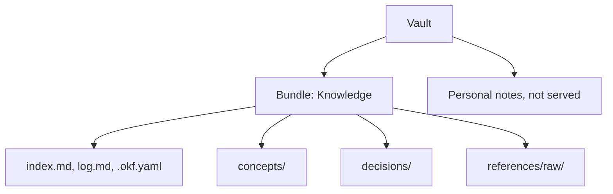

# OKF bundles

An OKF bundle is a folder of Markdown notes with YAML frontmatter that follows Open Knowledge Format
(OKF) v0.2. It is the unit OKF Wiki serves to agents: agents see the bundles you enable and nothing
else in your vault.

## How it works

Each note in a bundle is a concept. Its frontmatter says what it is (`type`), what it covers
(`title`, `description`, `tags`), where it came from (`sources`) and who wrote and checked it
(`generated`, `verified`). Its id is its path inside the bundle without `.md`, for example
`tables/orders`.

Besides the concepts, a bundle holds:

- `index.md` in each folder, listing that folder's notes grouped by `type`. OKF Wiki keeps these up
  to date on every write unless the bundle's policy turns it off.
- `log.md` at the root, recording every change with who made it and why.
- Optionally `.okf.yaml` at the root, the bundle's policy; see
  [Configuration](../reference/configuration.md#bundle-policy-okfyaml).

Any folder can become a bundle; OKF Wiki adds `index.md` and `log.md` as agents write. A folder that
already has an `index.md` and either a `.okf.yaml` or `okf_version` in its `index.md` frontmatter
declares itself a bundle, and OKF Wiki offers it under **Bundles** as `Found: <folder>`.

## One bundle or several

Links, `sources` and footnote citations cannot point outside their bundle, and the graph and
backlinks stop at its edge. Notes that link to each other belong in one bundle.

A second bundle pays off only at a real boundary:

- a different set of agents may read or write it (tokens can be limited to bundles);
- a different auto approve choice or `.okf.yaml` policy;
- a folder you share or sync on its own.

Bundles cannot be nested.

## Inside a bundle

Folders say what kind of note it is, for example `concepts/`, `playbooks/` and `decisions/`, with
original material in `references/raw/`. Tags say what it is about. A note has one folder but many
tags, and `okf_search` filters by both, so keep folders shallow.

## Limits

- The vault root, hidden folders and Obsidian's configuration folder cannot be bundles.
- Files reached through a symlink that leads outside the vault are not served.
- Agents write only `.md` files, so they cannot change `.okf.yaml`.

## Related

- [Check a bundle before you commit it](../examples/01-check-a-bundle-before-you-commit.md)
- [Lint codes](../reference/lint-codes.md)
- [Language policy and raw sources](language-policy-and-raw-sources.md)
