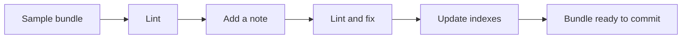

# Check a bundle before you commit it

In this example you add a note to an OKF bundle by hand, find what is wrong with it, fix it and bring
the bundle's indexes up to date, all with the `okf` tool. You start with a clean sample bundle and
end with a bundle that has one new note and passes a strict lint.

Tested with OKF Wiki 0.7.0 (`okf` built from source) on Windows 11 in Git Bash with Node.js 24.16.0,
2026-11-11.

## What you need

- The `okf` tool built in a clone of the repository; see [Installation](../installation.md#install-the-okf-tool).
  Run every command from the root of that clone.
- The sample bundle in [`test/fixtures/okf-bundles/crypto_bitcoin`](https://github.com/ysasiwat/obsidian-okf-wiki/tree/main/test/fixtures/okf-bundles/crypto_bitcoin).
- A POSIX shell (Linux, macOS, or Git Bash on Windows).

## The workflow at a glance



## 1. Copy the sample bundle

Work on a copy, so the sample stays as it is.

```sh
cp -r test/fixtures/okf-bundles/crypto_bitcoin my-bundle
```

## 2. Lint the bundle as it is

Linting first shows which findings were there before your change.

```sh
node dist/okf.cjs lint my-bundle
echo "exit=$?"
```

```text
  info    tables/outputs.md  [source-uncited] sources never cited in a footnote: outputs-table.
      fix: Attribute claims with footnotes keyed by sources[].id, e.g. `[^my-source]`.
  info    tables/transactions.md  [source-uncited] sources never cited in a footnote: bq-metadata, gcp-blog.
      fix: Attribute claims with footnotes keyed by sources[].id, e.g. `[^my-source]`.
0 error(s), 0 warning(s), 2 info
exit=0
```

Two info findings and exit code 0: the bundle passes.

## 3. Add a note the way you might type it in Obsidian

Create `my-bundle/tables/fees.md` with this content:

```sh
cat > my-bundle/tables/fees.md <<'EOF'
---
title: Transaction Fees
description: How fees are computed from inputs and outputs.
tags: fees, bitcoin
---

The fee is the input value minus the output value; see [[transactions]].
EOF
```

## 4. Lint again

```sh
node dist/okf.cjs lint my-bundle
echo "exit=$?"
```

```text
  error   tables/fees.md  [missing-type] Frontmatter has no non-empty `type` (OKF §4.1).
      fix: Add `type`, e.g. `type: Reference`.
  warning tables/fees.md  [tag-format] `tags` is a single string; OKF §4.1 expects a YAML list.
      fix: Write `tags: [a, b]` instead of `tags: a, b`.
  warning tables/fees.md  [wikilink] Wikilink [[transactions]] is not a standard markdown link (OKF §6.1).
      fix: Run 'Convert links to OKF form' or write `[text](relative/path.md)`.
  info    tables/outputs.md  [source-uncited] sources never cited in a footnote: outputs-table.
      fix: Attribute claims with footnotes keyed by sources[].id, e.g. `[^my-source]`.
  info    tables/transactions.md  [source-uncited] sources never cited in a footnote: bq-metadata, gcp-blog.
      fix: Attribute claims with footnotes keyed by sources[].id, e.g. `[^my-source]`.
1 error(s), 2 warning(s), 2 info
exit=1
```

The new note has one error and two warnings, each with a fix. The error makes `okf` exit with 1.
The codes are explained in [Lint codes](../reference/lint-codes.md).

## 5. Fix the note

Add `type`, write the tags as a list and use a relative markdown link:

```sh
cat > my-bundle/tables/fees.md <<'EOF'
---
type: Reference
title: Transaction Fees
description: How fees are computed from inputs and outputs.
tags: [fees, bitcoin]
---

The fee is the input value minus the output value; see [Transactions](transactions.md).
EOF
```

Lint with `--strict`, which also fails on warnings, and hide the info findings:

```sh
node dist/okf.cjs lint my-bundle --strict --min-severity warning
echo "exit=$?"
```

```text
0 error(s), 0 warning(s), 2 info
exit=0
```

The summary line still counts the info findings that `--min-severity` hid.

## 6. Bring the indexes up to date

Each folder's `index.md` lists its notes. Check whether the new note is missing from one:

```sh
node dist/okf.cjs index my-bundle
echo "exit=$?"
```

```text
would change tables/index.md
exit=1
```

Write the change:

```sh
node dist/okf.cjs index my-bundle --write
```

```text
wrote tables/index.md
```

## 7. Check the result

```sh
cat my-bundle/tables/index.md
```

```text
# BigQuery Table

* [Bitcoin Blocks Table](blocks.md) - All blocks from the Bitcoin blockchain, including block headers, transaction counts, sizes, and timestamps.
* [Bitcoin Outputs Table](outputs.md) - Outputs from all Bitcoin transactions, including script details and values in Satoshis.
* [Bitcoin Transaction Inputs](inputs.md) - Bitcoin transaction inputs detailing UTXOs spent.
* [Bitcoin Transactions Table](transactions.md) - All Bitcoin transactions containing inputs, outputs, block metadata, and fee structures.

# Reference

* [Transaction Fees](fees.md) - How fees are computed from inputs and outputs.
```

The index groups notes by `type`, so the new note gets its own `Reference` heading. Run the check
once more:

```sh
node dist/okf.cjs index my-bundle
```

```text
indexes are up to date
```

If the output differs, see [Troubleshooting](../troubleshooting.md).

## 8. Clean up

```sh
rm -rf my-bundle
```

## What you did

- Found an error and two warnings in a hand-written note before they reached the bundle.
- Fixed them with the hints `okf lint` printed.
- Regenerated the folder index so the new note is listed.

## Next steps

- [Check bundles in CI](../how-to/check-bundles-in-ci.md): run the same checks on every pull request.
- [OKF bundles](../concepts/okf-bundles.md): what a bundle is and how to organize one.
